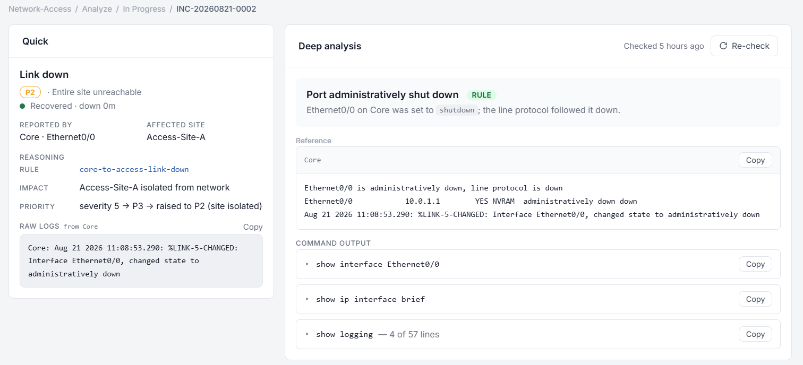

# Automated Incident Triage

Automatically detects network faults → opens a Trouble Ticket → classifies which team owns it → diagnoses the root cause.
Course project for ENE372/473, King Mongkut's University of Technology Thonburi (KMUTT).



*A real ticket from the lab. Core's link to Site A was shut down. The left side shows what the system decided in under a second (priority P2 because the whole site was cut off). The right side shows the root cause found over SSH, next to the unmodified router output it was based on.*

## How it works

```text
Routers (CML lab)
   │  syslog, UDP 514
   ▼
syslog_server.py    open/close ticket, classify team + priority
   │
   ▼
tickets.db (SQLite)
   │
   ├─▶ diagnose_worker.py   SSH in, find root cause with rules
   │      │  rules can't explain it
   │      ▼
   │   analyze_pending.py   ask a local LLM (Ollama)
   │
   └─▶ Dashboard            operator confirms or corrects the team
```

- **Tickets open and close automatically** from `%LINK-*` syslog messages (`down` → open, `up` → close)
- **Owner group + priority classification** using keyword rules (word-boundary matching), escalated by impact (a whole site down → at least P2)
- **Hybrid root-cause analysis**: rules first, LLM only for cases the rules don't cover
- **Human-in-the-loop**: the system suggests a team, but an operator must confirm it on the dashboard

## Results

Measured on the CML lab in August 2026, against targets set in the project proposal.

| What was measured | Target | Result |
| :-- | :-- | :-- |
| Time from syslog event to ticket shown with team + priority | ≤ 5 s | **0.97 s average, 1.60 s worst** (40 runs, 20 Aug) |
| Team classification accepted by the operator without correction | ≥ 80% | **97.4%** (38 of 39 reference cases) |
| Tickets the system closed on its own without a human | 0% | **0%** |
| Tickets showing the raw, unmodified device output next to the analysis | 100% | **100%** (111 of 111 tickets) |
| Software licence cost | 0 baht | **0 baht** |

Timing is measured from the timestamp inside the router's syslog message. The router clocks ran 0.3–1.6 s behind the PC, so the real times are slightly shorter than the numbers above.

For root-cause analysis I fed the same 13 test cases to three approaches (`llama3.1:8b`, temperature 0):

| | Rules only | LLM only | Hybrid (this project) |
| :-- | --: | --: | --: |
| Correct answer | 8/13 (62%) | 7/13 (54%) | **11/13 (85%)** |
| Made-up answer when it should have said "not enough data" | **0** | 6 | 1 |
| Average time per case | **0.00 s** | 7.15 s | 6.89 s |

The hybrid approach only calls the LLM when the rules can't explain a fault, and then checks that what the model cites actually appears in the device output. 12 of the 13 cases are simulated. On the one case built from real lab output, the hybrid still gave a wrong answer: the model quoted a number that does exist in the output, but the wrong one, so the check let it through. Expect real-world accuracy to be lower than 85%.

## Project layout

| Part | Files |
| :-- | :-- |
| Core services | `syslog_server.py`, `diagnose_worker.py`, `analyze_pending.py` |
| Fault injection | `fault_injection.py`, `inject_menu.py`, `c06_congestion.py` |
| Library | `lib/` — syslog parser, classifier, correlation, diagnostics, cause rules, LLM client, etc. |
| Dashboard | `dashboard/backend/app.py` (Flask API), `dashboard/frontend/` |
| Testing / measurement | `measure_latency.py`, `run_*_batch.py`, `test_dispositions.py`, `replay_syslog.py`, `testcases/`, `tools/` |
| Windows shortcuts | `0_` – `8_*.bat` |

Code comments and console output are in Thai.

## Setup

Requires Python 3 (on Windows the command is `py`).

```bat
py -m pip install -r requirements.txt
copy lib\lab_secrets.example.py lib\lab_secrets.py
```

Then edit `lib\lab_secrets.py` with the router username/password for your lab.
Device IPs and ports are set in `lib/mapping.py` (`DEVICE_SSH`) and `fault_injection.py` (`CORE`).

The LLM analysis step needs [Ollama](https://ollama.com) with the `llama3.1:8b` model pulled.

## Running

Open several terminals at once (or double-click the numbered `.bat` files):

| Terminal | Command | |
| :-- | :-- | :-- |
| 1 | `py syslog_server.py` | Listens for syslog — keep running |
| 2 | `py diagnose_worker.py` | SSH diagnosis — keep running |
| 3 | `py dashboard\backend\app.py` | Dashboard API, then open `dashboard\frontend\index.html` |
| 4 | `py inject_menu.py` | Inject test faults |

Test the logic without the lab: `py lib\<file>.py` (every module in `lib/` has unit tests with sample data).

## My role

Solo project. I designed and built all of it: the CML lab and router config, the syslog-to-ticket pipeline, the classification and correlation rules, SSH diagnosis and the hybrid rule + LLM analysis, the Flask dashboard, and the test and measurement scripts used for the results above.

## Lab

Star topology on Cisco Modeling Labs (CML): one Core router, with Access Sites A/B/C each connected to the Core on its own link.
Faults must be injected on the Core, because IOL does not propagate carrier loss to the far end of a link.
